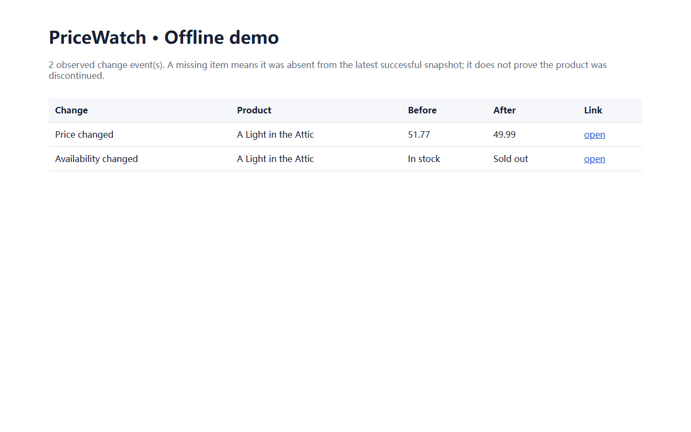

# PriceWatch
### Historical price snapshots & change detection

A configurable Python monitoring pipeline that converts product listings into source-specific SQLite history, structured change events and readable HTML reports.

[Developer profile & résumé](https://github.com/zhuyy86/leadreview/blob/main/PROFILE.md) · [Usage reference](USAGE.md) · [Project walkthrough](PROJECT_EXPLAINED_FOR_ME.md) · [Test report](TEST_REPORT.md) · [Source & license](UPSTREAM.md)



## Business workflow

**Collect → Normalize → Commit snapshot → Compare history → Report changes**

A sequence of scraped files is difficult to compare reliably. PriceWatch models observations as snapshots and compares each successful run with the previous run for the same source.

## Engineering highlights

- **Configurable collection:** YAML site settings and CSS selectors separate extraction configuration from code.
- **Recoverable export queue:** snapshot rows, change-derived CSV/HTML/alert payloads and checksums commit together. Staged publication, durable receipts and offline recovery close the database-to-file boundary. CSV rows are stored incrementally and reconstructed in commit order.
- **Transactional persistence:** `BEGIN IMMEDIATE` reserves the SQLite writer before reading the previous snapshot, so competing saves compare against their immediate committed predecessor. Snapshot rows and run metadata commit together; connections close explicitly after use. Separate sources retain independent history.
- **Stable identity:** product keys support comparison across runs.
- **Explicit change model:** added, removed, price-change and availability-change events include the comparison context.
- **Report generation:** escaped HTML output presents changes for review.
- **Rule-based alerts:** configurable target prices and minimum discounts produce structured alert JSON for downstream integrations.

An item marked removed was absent from the latest successful snapshot. The event records an observation rather than assuming a product was discontinued.

## Architecture

```text
YAML configuration
        |
Requests / BeautifulSoup extraction
        |
Normalized product observations
        |
Atomic SQLite snapshots
        |
Diff events / HTML report / Alert JSON
```

## Verification

The current suite passes **72 automated tests** for parsing, configuration, storage, history, alerts and CLI preflight validation. A controlled two-writer race reproduces and guards against stale snapshot comparisons. A failure injected after run creation verifies that partial snapshot rows and run metadata roll back together. Offline fixtures and a two-run demonstration exercise comparison without depending on an external website. See [TEST_REPORT.md](TEST_REPORT.md).

## Run

```sh
python -m pip install -r requirements.txt
python scripts/demo_history.py
python scripts/demo_alerts.py
python -m pytest -q
```

For a configured source:

```sh
python -m price_scraper -c config.yaml --database outputs/history.db --report outputs/latest-changes.html
```

Configure collection frequency and access according to the target site's published rules. Full flags and configuration examples are in the [usage reference](USAGE.md).

## Stack

Python · Requests · BeautifulSoup · SQLite · YAML · pytest

## Development & attribution

Independent portfolio extension of an MIT-licensed configurable scraper, developed with Codex assistance. Snapshot persistence, change events and reporting extend the upstream collection pipeline. See [UPSTREAM.md](UPSTREAM.md) and [LICENSE](LICENSE).


## Reproduce export recovery

```sh
python scripts/verify_export_recovery.py --runs 500 --products 20
```

The [recorded local workload](docs/recovery-workload.json) seeded 500 snapshots, 1,500 export intents and 10,000 CSV rows. A fault after the first file publication interrupted its receipt. Two bounded recovery passes published all 1,500 receipts and preserved one CSV contribution per run/product. Stored CSV payload bytes equal the final file size because intents keep incremental rows. The record includes runtime, host platform, observation time and measured durations; reproduce it to obtain timings for your host. Linux/Windows CI runs a smaller 20-run case.
